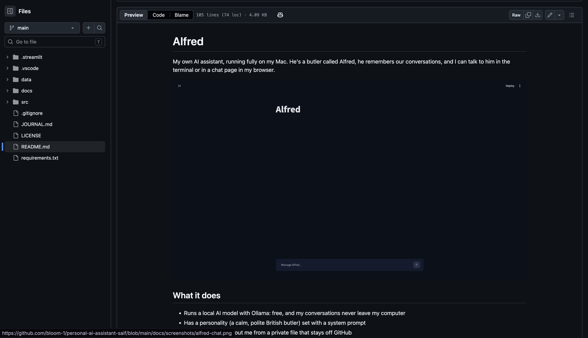
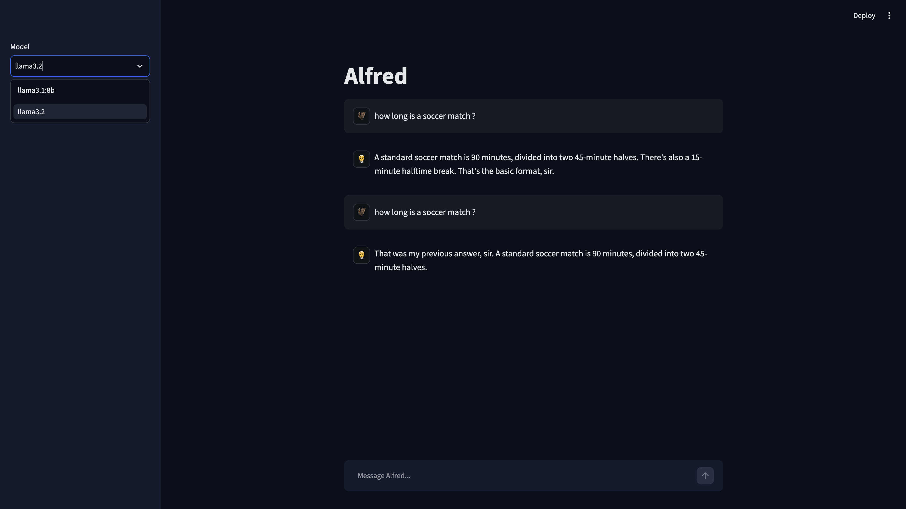
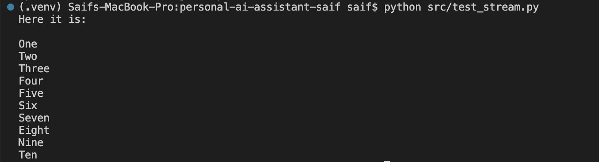
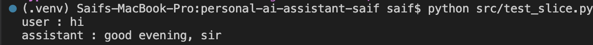
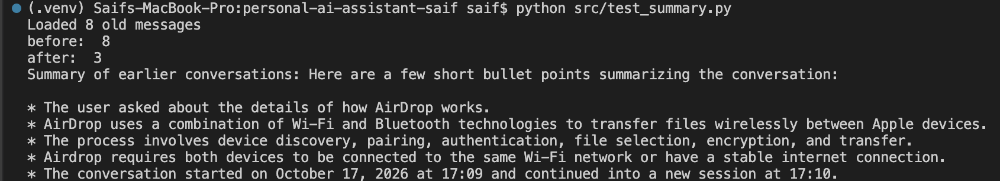
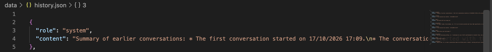

# Build Journal

## Stage 0: Setup (12/10/2026)

### what i wanted to do
get everything ready before coding anything: editor, python, repo, venv

### what i did
- picked python over c. i practice c more but for ai stuff python is just easier, no malloc or pointers to deal with and there's libraries for everything
- made the repo on github with a readme, the python .gitignore and an mit license, then cloned it
- made a ~/Projects folder and moved the repo there. didn't put it on the desktop because of icloud sync, the venv has thousands of files
- upgraded python (had 3.10.6, basically end of life) to 3.15
- created the venv and activated it
- set up the folders + a vs code setting so screenshots i paste go straight into docs/screenshots

### Screenshots

### problems
- forgot to cd before cloning so the repo ended up in my home folder. used `pwd` and `ls` to see where i was then moved it with `mv` to Projects
- 3.10.6 still worked but it's getting dropped. upgraded before making the venv because the venv is stuck with the python version that created it
- `code .` gave "command not found". the code command isn't installed by default on mac, you have to do cmd+shift+p > "Shell Command: Install 'code' command in PATH" in vs code
- wasn't sure if docs/ and .vscode/ go inside .venv or not. they go outside at the root, .venv is just for libraries

### what i learned
- venv = separate box of libraries for each project so they don't mess with each other
- .gitignore keeps the venv (and later secrets) off github
- every new terminal starts in ~ with the venv off, so it's `cd` + `source .venv/bin/activate` every time

## Stage 1: first message to the AI (12/10/2026)

goal: get my python script to send one message to an AI and print the answer. no chat yet just checking it works

### why ollama and not claude
was going to use the claude API but you have to pay for it so no. went with ollama instead, it's free and the model runs directly on my mac so nothing leaves my computer. it's less smart than claude but whatever, for learning it's fine. it asked me to log in, skipped it, don't need an account for local stuff

### what i did
- installed ollama (v0.40.3)
- `ollama pull llama3.2` to download the model, like 2gb
- tested it in the terminal with `ollama run llama3.2` before coding anything. that way if my code breaks i know it's my code and not the model
- `pip install ollama` then `pip freeze > requirements.txt`
- wrote src/main.py, it sends one message and prints the reply
- added comments so i don't forget what stuff does

### how i understand it
the ollama app = a server on my mac, it's what actually runs the model
the ollama python library = just sends my message to that server and gets the answer back
same name, two different things, confused me at first

### screenshots

### problems
- typed `ollama --version` and `ollama pull` on the same line, didn't work obviously. one command per line
- typed just `ollama` and got some weird menu with claude code and other stuff. esc to get out. it needs `pull` or `run` after
- after `ollama run` i typed `python src/main.py` and it sent it to the AI as a message lol. i was still in the chat (the `>>>` thing). `/bye` to get out. now i look at the prompt before typing
- i thought my script would work even without the ollama app since i was using the library. and it did work... but only because the server was still running in the background even after closing the app. checked with `curl http://localhost:11434` and it said "Ollama is running". killed it with `pkill ollama` and then the script crashed with a ConnectionError. so i was wrong, no server = nothing to talk to

### what i learned
- test each part alone before putting them together
- the library talks, the app does the work

## Stage 2: chat loop (12/10/2026)

goal: being able to chat back and forth in the terminal instead of sending just one message. it should keep going until i type quit

### my prediction before testing
if i tell it my name and then ask what my name is, i think it'll remember since it's the same conversation

### what i did 
- replaced the code with a `while True` loop 
- `input("You: ")` waits for me to type
- if i type quit it prints bye and `break` gets out of the loop
- `.lower()` so it works even if i type QUIT

### screenshots

### result
nope, didn't remember my name. so i was wrong

### why
turns out the model has zero memory. every loop i'm creating a new `messages` list with just what i typed, so when i asked "what's my name?" that's literally the only thing it got. it never saw the first message

so chatgpt and claude don't really "remember" either, the app just sends the whole conversation again every time. gonna do that next

### problems
- nothing broke in the code itself, it ran first try
- the "problem" was my prediction, i thought it'd remember my name and it didn't. explained in the result part

## Stage 3: giving it memory (12/10/2026)

goal: make it remember the conversation. idea is to keep one list with every message (mine and the bot's) and send the whole thing each time

### my prediction
should remember my name now since it'll see the whole conversation every time

### screenshots

### what i changed
- moved `messages = []` before the loop so it's created once and doesn't get wiped every turn
- `append` my message, send the whole list, then `append` the bot's answer too
- role "assistant" is the bot's messages, so it knows who said what

### result
it remembers now. asked my name and the first thing i said and it got both

added a debug print with `len(messages)` to see the list grow, goes up by 2 every turn (my message + its answer). removed it after

### PS
the list just keeps growing so long chats which means there's more to send every time, probably gets slower. also everything is gone when i close the program

### problems
- added the debug print but couldn't see it when running. it has to be inside the loop, right under `print("Bot:", reply)` with the exact same indentation, otherwise it doesn't run every turn. moved it and the count showed up
- learned to look at the vertical lines in vs code to see which block a line belongs to

## Stage 4: giving it a personality (12/10/2026)

goal: give my bot a name, a way of talking and some rules. there's a 3rd role called "system", it's a hidden message at the start of the convo that tells the model how to act

### my prediction
i think it's gonna work really well, especially when i gave it more info, rules and told it how to behave with me. 

### my system prompt
"""
You're Alfred, my personal assistant. Think classy British butler: polite, calm, loyal.

How you talk:
- call me "sir" sometimes, not every message
- you can be a bit sarcastic/witty but don't overdo it
- if I'm about to do something dumb, tell me (politely)

Rules:
- short answers, 3 sentences max unless I ask for more
- answer in the language I use (french or english)
- if you don't know something just say it, don't invent stuff
- answer the question first, jokes after

About me:
- I'm Saif, engineering student
- I like straight answers, no long speeches
"""

### screenshots

### what i changed
- added a SYSTEM_PROMPT at the top with alfred's personality and rules
- the messages list now starts with the system message in it instead of being empty, so the model reads the personality first every time
- changed "Bot:" to "Alfred:" in the print

### result
- he says who he is and calls me sir
- kept it short and went longer when i asked
- answered in french when i wrote in french
- made something up about what i ate
- told me not to skip school

about the debug count: the list starts with 1 thing now (the system message) so it would go 3, 5, 7 instead of 2, 4, 6

### what i noticed
llama3.2 is small so it doesn't follow every rule perfectly. the more precise the rule the better it follows it

### hallucination
asked "what did i eat today" and he just made something up even though my rule says not to. that's called a hallucination, the model predicts words that sound right, it doesn't know that it doesn't know

changed the rule to be more specific: told him he only knows what i say in the chat and to say he doesn't know if i never told him. after that he said he didn't know
### problems
- first version of the system prompt was too clean and didn't sound like me, rewrote it my way but kept the precise rules like "3 sentences max"
- asked "what did i eat today" and he made something up even though the rules said not to (more in the hallucination part)

## Stage 5: private info file (12/10/2026)

goal: give alfred personal info about me without putting it on github. the "about me" part is in main.py right now and my repo is public so anyone can read it. moving it to a separate file that git ignores

### screenshots

### what i did
- moved the "about me" part out of main.py into data/about_me.txt
- added data/about_me.txt to .gitignore so it stays on my mac
- made about_me.example.txt with fake info, that one goes on github so people know what the file should look like
- the code reads the file at the start with `open()` and sticks it at the end of the system prompt

### result
alfred knows the stuff from my file now, and source control doesn't show about_me.txt so it's not going on github, renamed the file to see what happens if it's missing: FileNotFoundError: [Errno 2] No such file or directory: 'data/about_me_of.txt'. makes sense, the code tries to open a file that's not there

### stuff i learned
- public code, private data. same idea as .env for api keys

### problems
- nothing broke this time

## Stage 5b: saving conversations (13/10/2026)

goal: alfred forgets everything when i close the program because the messages list only exists while it runs. going to save the convo in a file after every answer and load it back when it starts

### my prediction
the first time it will tell me that there are 0 or X old messages, i will test it with a question about what i ate or something, close the program, and ask it what i ate. I think it will work. 

### screenshots

### problems
- got a JSONDecodeError on startup. history.json existed but was empty, and an empty file isn't valid json. my code only checked if the file existed, not if what's inside was ok
- could happen for real: "w" mode empties the file as soon as it opens, so if the program stops right while saving you get an empty file
- fixed it with try/except around json.load only. first version caught every error with a bare `except:`, bad idea because it would hide other bugs, now it only catches JSONDecodeError
- also forgot the else at first so if the file didn't exist `history` was never created
- after the fix it said "loaded 4 old messages" but alfred acted like he didn't remember anything. printed len(messages) before the loop and got 9 (system + 8 old ones) so the code was fine, he was getting the history
- opened history.json: the burger message was there but also his answers saying "i don't remember anything". so after every restart he was rereading himself saying that and kept going with it. my questions were also super vague ("what was our last conversation?") which makes small models give the default "i don't keep memories" answer
- deleted the file, told him what i ate, restarted and asked "what did i have for lunch?" and he got it
- also he said my burger was "a bit of a rushed affair" which i never said, hallucination++
- after fixing the prompt: "what did i eat?" works but "what was our last conversation about?" and he made up something about my daily schedule. finding one fact is easy for him but summarizing is harder so he guesses
- also realized history.json is just one long list with no dates, so he can't even tell where the last conversation starts. he doesn't know when anything was said
- history.json was one long list with no dates so alfred couldn't tell where the last convo started. now when the program starts and there's old history, it adds a system message with the date and time like "A new session has started : 13/10/2026 12:37"
- typed `message` instead of `messages` so it was appending to a list that doesn't exist
- put `print(...)` inside the content. print shows text but returns None, so the content would've been None. an f-string on its own is already text, no need for print
- first date format had commas everywhere, looked like a list of numbers. switched to `%d/%m/%Y %H:%M`

### result
- told him what i ate, quit, restarted and he remembered. the file is just my convo saved as json
- the date comes up at the start of every session, and is shown in the history.json file

### stuff i learned
- json = text format to save lists and dictionaries
- save after every answer, not just on quit, otherwise a crash loses everything
- try/except only around the line that can fail, and catch the specific error, not everything
- when the code is right but the bot acts weird, check what it actually receives (print it) and what's in the data
- change one thing at a time when testing, otherwise you don't know what fixed it

### bigger model test
- tried llama3.1:8b (8 billion parameters) instead of llama3.2 (3 billion). with 16gb of ram my mac handles it fine, answers come in like 3 seconds max changed only the model, same test as before so it's a fair comparison. the 8b one is just better overall, follows the rules and the convo better. keeping it also put the model name in a constant at the top OLLA so switching models is one line now

## Stage 6: chat interface in the browser (13/10/2026)

goal: chat with alfred in a real web page instead of the terminal. using streamlit, it turns a python script into a web page so no html/css needed. keeping main.py for the terminal version and making a new app.py for the web one

picked streamlit because it's pure python and has chat stuff built in. other options were gradio, flask/fastapi with html/js (more control but takes time to code) or a telegram bot. might do a fastapi version later

#### problems (setup)
- `pip install streamlit` crashed on pyarrow. in the log there was `pyarrow!=25.0.0,<26` so streamlit only accepts pyarrow below 26, but only pyarrow 26 has a ready-made version for python 3.15. so pip took 25.0.1 as source code (.tar.gz instead of .whl), tried to compile it and failed
- switched the project to python 3.14. committed first just in case, deleted .venv, made a new one with python3.14 and reinstalled everything with `pip install -r requirements.txt`. didn't touch my code at all
- so the newest python isn't always the best idea, libraries need time to catch up. and the real answer was in the dependency lines, not the big error at the bottom
- after that alfred took like 5s instead of 3 for the first answer. not python's fault, ollama unloads the model when it's not used for a while so it has to load it again

### 6.1 first page (14/10/2026)
made src/app.py, 2 lines: import streamlit and a title. you run it with `streamlit run` instead of `python`, it opens a page in the browser at localhost:8501. the terminal stays busy while the app runs, ctrl+c to stop it

#### screenshots

#### problems
- `streamlit: command not found`, the venv wasn't active (new terminal, new day). `source .venv/bin/activate` fixed it
- a weird `DeltaGenerator(...)` line showed up in the terminal. i had a print around st.title, same mistake as the print inside content in 5B. st.title already shows the title on the page, no print needed
- the terminal shows a "Network URL" = anyone on the same wifi can open my app. fine for now but i'll need to lock it to my mac only before connecting alfred

### 6.2 the counter test (14/10/2026)
streamlit reruns the whole script every time i click something. made a counter with a button to see what that does

#### prediction
i think the counter will work and add up normally

#### screenshots

#### problems
- added `clicked = False` at the end to "reset" the button, but it did nothing. the variable isn't used after and gets a new value on the next rerun anyway, so deleted it
- first try with session_state was a mess: i read `st.session_state["count"]` before creating it, checked `"count" not in count` instead of in session_state, and wrote `["count":0]` instead of `["count"] = 0`
- also did `count += 1` on a copy, so the value in session_state never changed

#### result
stuck at 1. every click reruns the whole file so `count = 0` runs again every single time

st.session_state fixes it, it's like a dictionary that streamlit keeps alive between reruns. i only set count to 0 if it's not in there yet, then add 1 directly to the one in session_state. a normal variable is just a copy

### 6.3 chat page, no ai yet (15/10/2026)
made the chat interface with an echo bot that just repeats what i type, so if something breaks i know it's the interface and not ollama

- st.chat_input = the input box at the bottom, gives back what i typed or None
- st.chat_message("user" / "assistant") = a bubble
- messages saved in st.session_state as a list, same format as alfred's (role + content)
- a for loop redraws every old message on each rerun, otherwise they'd disappear

#### screenshots

#### problems
- typed `st.session_State` with a capital S, python is case sensitive
- tried to get the role straight from the whole list (`st.session_state["messages"]["role"]`). a list doesn't have a role, each message inside it does. that's what the for loop is for, it gives me one message at a time
- wrote `msg["role"]["content"]` like content was inside role, but they're two separate fields of the same message
- for the new message i used `msg` but it only exists inside the loop. the new text is in the variable from chat_input
- used `NULL` like in c, in python it's `None`. and `if user_inp:` is enough since None counts as false
- appended `["user"]` instead of a full dictionary with role and content

#### prediction (refresh)
the messages won't be there because they are not stored anywhere

#### result
the messages dissapeared, session_state survives reruns but a refresh = new session, so the list starts empty again. i'll need history.json like in main.py

### 6.4 locking the app to my mac
the terminal showed a network url, so anyone on the same wifi (like at school) could open alfred and read my stuff once he's connected. made .streamlit/config.toml with a [server] section and address = "localhost". the log went from `started on :::8501` (every network) to `started on localhost:8501` (only my mac) and the network url is gone

#### problems
- didn't get the toml format at first, wrote `key = "value"` literally then `dark = "dark"`. a section in [ ], then the setting name = the value
- streamlit detected the config change by itself and said to restart it
- first refresh test said "site cannot be reached", the app wasn't running (i had stopped it with ctrl+c). the browser page is just a client, it needs the streamlit server running in the terminal

### screenshots

### 6.5 moving alfred's logic into its own file (15/10/2026)
goal: put all of alfred's logic in src/alfred.py so main.py and app.py use the same code. otherwise i'd have the prompt in two places and if i change one and forget the other, the two alfreds act different

made 4:
- `load_history()` loads history.json and gives back the list
- `save_history(messages)` saves the convo
- `start_messages()` builds the whole starting list (prompt + about me + history + session marker)
- `ask_alfred(messages)` sends everything to ollama and gives back the reply

did them one by one and tested each one alone with a temporary file (src/test_alfred.py)

#### load_history()
first i wrote `return json.load(f)` directly, but then my "loaded X old messages" print never ran because return ends the function right there. it also used a `history` variable that didn't exist anymore. so now i store it in a variable, print, then return

#### save_history(messages)
just my saving block in a function, takes the list as input. no return, it only writes the file

tested it: 26 messages, added a test message, saved with a fake system message in front, loaded again → 27. the fake system message got skipped by `[1:]` like it should

#### start_messages()
moved the about_me reading inside the function, so now nothing runs outside functions in alfred.py except the constants. it calls load_history() instead of copying the code

tested it: 29 = 1 system + 27 history + 1 marker. 27 because i forgot to delete the test message from before

#### ask_alfred(messages)
sends the list to ollama and gives back just the text. it doesn't append or save anything, main.py decides what to do with the answer. tested it with fake messages so my real history wasn't touched

### screenshots 

#### problems
- typed `python run src/test_alfred.py` out of habit from streamlit. python takes the file directly, only streamlit needs `run`. the error said it couldn't find a file called run
- `save_history() takes 0 positional arguments but 1 was given`: forgot `messages` in the parentheses of the def, so the function didn't accept any input
- `object of type 'function' has no len()`: wrote `load_history` without the (). without () you get the function itself, with () you run it and get what it returns
- code at the top of alfred.py (outside functions) runs as soon as another file imports it. had `full_prompt = ... + about_me` up there after moving the about_me reading into the function, so about_me didn't exist anymore. moved it inside start_messages()
- in start_messages i called `load_history()` without storing the result so `history` didn't exist, used `full_date` before creating it (python runs top to bottom), and forgot `return messages` so it would've given back None
- had comments like "FIXED: ..." in the code. comments should say what the code does, the history of changes is what git commits are for. removed them
- ask_alfred test crashed with a ValidationError inside ollama. it said the `role` field was missing and showed my message with `roles` in it. typo in the test file, not in the function. the crash showed up in alfred.py but the mistake was in the data i passed in

#### switching main.py to alfred.py
main.py went from 80 lines to 18. it only does the terminal stuff now (input, quit, print) and calls alfred.py for the rest. the appends stay in main.py since ask_alfred only gives back the reply

#### problems (main.py switch)
- imported load_history but main.py never uses it, start_messages already calls it. removed it
- wrote the message with [ ] instead of { }. [ ] = list, { } = dictionary, a message is a dictionary
- had "me" in quotes so it would've saved the word "me" every time instead of what i typed. variables go without quotes
- called ask_alfred(messages) without storing the result, the reply just disappeared. same mistake as load_history in start_messages

#### result
alfred did remember our last conversation and the count went up

### Stage 6.6 : connect Alfred to the chat page.(16/10/2026)
replaced the echo bot with the real alfred using the same functions as main.py: start_messages() for the starting list, ask_alfred() for the reply, save_history() after each answer

#### prediction
the history will be saved and we will continue where we left off

#### problems
- first version gave my text (user_inp) to ask_alfred and save_history instead of the whole list. alfred would've gotten one sentence instead of the convo, and save_history would've replaced my whole history.json with a piece of text. made a backup before testing just in case
- was saving twice per message, once is enough, after alfred's reply is in the list
- the save was inside the assistant bubble, worked but made no sense so i moved it out
- the backup file wasn't in .gitignore so it would've gone on github, added it

#### result
works. after cmd+r everything comes back, even what i wrote right before refreshing. session_state still resets but start_messages() reloads history.json, and since it saves after every answer the file is always up to date

checked the numbers: 29 at first, +1 session marker, +4 for 2 exchanges = 34 after refresh

the "loaded X old messages" shows in the terminal, not the page. print always goes to the terminal where streamlit runs, only st.something shows on the page

### screenshots

### 6.7 making it look like mine (16/10/2026)
the default red and orange looked ugly so i went darker, black and blue

- 🦇 for me and 🤵 for alfred. made an AVATARS dictionary at the top so in the loop i just do `AVATARS[msg["role"]]`. changing an emoji = one line
- colors: added primaryColor, backgroundColor, secondaryBackgroundColor and textColor in config.toml with dark navy / blue hex codes

#### screenshots

#### problems
- put the avatars only on the 2 bubbles drawn after i send something, but the screen was still full of default icons. every rerun the loop redraws everything and the loop had no avatar, so i had to add it in all 3 places
- passed the emoji without a name like `st.chat_message("user", "🦇")`, it's better with `avatar="🦇"`
- the red border on the input box was primaryColor, made it blue

## Stage 7: finishing (16/10/2026)

### 7.1 docstrings
added a docstring to every function in alfred.py, what it does, what it takes, what it gives back. it's a triple quote string right at the start of the function. when i hover over the function in vs code it shows up

#### problems
- my first versions were just wrong. said start_messages returns a welcome message (it returns the list), ask_alfred sends the last message (it sends the whole convo), messages is a dictionary (it's a list of dictionaries), save_history skips a "welcome message" (it's the system message)
- a wrong docstring is worse than nothing since people trust it. had to reread my own code line by line to get it right

### screenshots

### 7.2 clear conversation button
added a sidebar with a "clear conversation" button. click it and clear_history() empties history.json, start_messages() makes a fresh list (no history), and st.rerun() redraws the page so the old bubbles go away

made a new function clear_history() for it, basically save_history but it writes an empty list and takes nothing

order matters: empty the file first, then rebuild. start_messages() loads the file so if i rebuild first i'd just get the old convo back

#### problems
- clear_history had `messages` in its () even though it doesn't use it, and app.py calls it with nothing, so it would've crashed
- tried `load_history(st.session_state["messages"])` to rebuild. wrong function (it only gives the history, not alfred's personality), wrong input (it takes nothing) and the result wasn't even stored. start_messages() does the whole thing
- after clearing i asked what we talked about last time and he made something up. with no history he had no idea there was nothing before, and my prompt even says earlier messages are old convos. so in start_messages, if there's no history, i add a system message saying it's the first conversation
- my first version of that note said "there is no history at all". but save_history saves it too, so next time alfred would read in his own history that there's no history 🙃 changed it to "the very first conversation started on [date]. nothing was said before this point", that stays true forever
- anything that gets saved has to still make sense when it's loaded later

#### result
after clearing he says there was nothing before. after chatting and refreshing he remembers the new stuff

### screenshots

### 7.3 cleanup
went through the whole repo before writing the readme:
- fixed comments that didn't match the code anymore
- cleaned the system prompt, there was a line i pasted by accident ("keep the anti-hallucination part") and the same rule written like 3 times
- renamed user_inp to user_input so app.py and main.py match
- typos and spacing (no space before `:`, 2 empty lines between functions)
- start_messages() doesn't crash anymore if about_me.txt is missing, it prints a warning and uses an empty string. same if/else as load_history. put the path in a constant ABOUT_ME_FILE too
- got about_me.example.txt back with `git checkout HEAD -- data/about_me.example.txt`, didn't know git could do that

#### problems
- deleted about_me.example.txt because i thought it was useless. but about_me.txt is gitignored, so anyone cloning the repo would crash right away with no idea what to put in that file

### screenshots

### stage 7 done
Alfred is "finished" for a first version: docstrings, clear button, cleanup, and a readme. the repo looks good. 

## Feature: model picker (17/10/2026)
added a dropdown in the sidebar to switch between llama3.1:8b and llama3.2 live

learned about default values for function inputs: `def ask_alfred(messages, model=MODEL)`. if nobody gives a model it uses MODEL, so main.py didn't need any change. st.selectbox remembers its value between reruns by itself, no session_state needed

#### prediction
he'll still remember the convo since i'm only changing the model, not the conversation

#### problems
- added `model` as an input but still used MODEL inside ollama.chat, so the dropdown wouldn't have done anything. MODEL and model aren't the same thing
- wrote "llama 3.2" with a space, it has to match `ollama list` exactly
- my list was still called YOUR_LIST (the placeholder from a hint), renamed it MODELS

#### result
switched models in the middle of a convo and the new one remembered everything. the memory isn't in the model at all, it's in my list. the whole list gets sent every time so any model can just pick it up

### screenshots

## Feature: streaming (17/10/2026)
goal: the answer shows up word by word while he writes it, instead of everything at once after a few seconds

tested it alone first in test_stream.py with `stream=True`. ollama sends the answer in small pieces and a for loop goes through them as they come. took out `end=""` to see what happens and every piece went on its own line. the pieces are tokens, sometimes a word, a number, a dot... that's literally how the model writes, one token at a time

generators: a function with `yield` instead of `return` gives back stuff one piece at a time

### screenshots

#### in the app
new function stream_alfred() in alfred.py, same as ask_alfred but with `stream=True` and a loop that yields each piece. kept ask_alfred for main.py

in app.py st.write_stream() takes the generator, shows the pieces live and gives back the full text at the end so i can still save it. the bubble has to be opened first, then the stream goes inside it

#### problems
- first wrote `print(yield(...))`, yield replaces print, it doesn't go inside it. the caller is the one that shows the pieces
- docstring said "returns nothing", but it gives back pieces one by one
- put write_stream outside the bubble and kept st.write(reply) inside it, so the answer would've shown twice (once without a bubble, once in it)
- forgot to pass the model, the dropdown would've stopped working

#### result
it takes 2-3s to think and then shows the answer word by word. 

## Feature: long memory summary (17/10/2026)
problem: the model can only read so much at once (the context window, in tokens). the history keeps growing and when it doesn't fit anymore the oldest part just gets cut off, no error, nothing. alfred would forget the start without saying it, and get slower too

fix: when the history is longer than MAX_HISTORY, i take the old part (everything except the last KEEP_RECENT), turn it into text, ask the model to summarize it, and replace it with one system message with the summary. recent messages stay the same

- messages_to_text() turns a list of messages into "role: content" lines
- summarize_history() gives back the history unchanged if it's short, otherwise summary + recent messages
- negative slicing: `history[-10:]` = last 10, `history[:-10]` = everything except the last 10

#### tests
- short history (8 messages, limit 30) → returned unchanged
- lowered the limits to 6 and 2 to test the long case → 8 became 3 (1 summary + 2 recent)

#### problems
- reused the same variable for a list and then a string (old_text, sum_hist), confusing so i renamed them
- first summary started with "here are a few short bullet points...", useless filler that would end up in his memory. told it: only bullet points, only stuff that was actually said, keep dates exactly as written
- it also rewrote my date 17/10/2026 as 10/17/2026 (american format), so summaries can change details without you noticing
- the summaries had wrong airdrop stuff (needs the same wifi, relaying through access points, aes-128-gcm). checked history.json and it was all in alfred's original answer, he made it up when i asked. the summary didn't invent anything, it just kept it. so a summary is only as true as the convo, and it turns old mistakes into permanent memory
- that original answer sounded super confident and detailed, that's the dangerous kind of hallucination. a small local model is fine for chatting but not for technical facts, always check real docs
- the 2nd summary dropped the "same wifi" thing, so summaries can also just lose stuff
- the original answer also ignored the "3 sentences max" rule, small models drop rules when you ask for detail

#### plugging it in
in start_messages: `history = summarize_history(load_history())`. load_history runs first and its result goes straight into summarize_history

didn't have to change save_history at all: it just saves messages[1:], and after a summary that list is shorter, so history.json gets overwritten with the short version. each function does one job so the new feature plugged in without touching the others

### screenshots

#### choosing the limits
didn't know what numbers to pick so i checked `ollama ps` while alfred was loaded. context is 4096 tokens, that's the max he can read at once. also saw he takes 5.3gb of ram and runs fully on the gpu, and the UNTIL column is when ollama unloads him, that's why the first answer after a break is slower

a token is roughly 4 characters. my system prompt + about_me already take around 500, and he needs around 500 left to answer, so that leaves like 3000 for the history. went with MAX_HISTORY = 20 and KEEP_RECENT = 8 so there's some margin when he gives long answers

counting messages isn't really precise though, one long answer from him weighs way more than a short message from me. counting characters would be better, maybe later